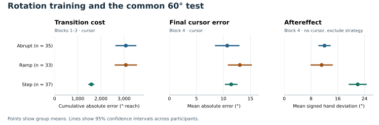

# 회전을 바꿀 때의 오차와 커서를 껐을 때 남는 적응

Modchalingam 등(2023)의 공개 자료로 105명의 도달 운동을 재분석했습니다. 원 논문이 보고한 공통 최종 검사 결과를 재현했습니다. 회전을 블록마다 15°씩 높인 집단은 커서를 끄고 의식적 보정 전략을 배제하라는 지시를 받았을 때 손을 약 22° 보정했습니다. 즉시 변경군과 시행별 변경군에서는 11~12°였습니다. 같은 사람의 전환 중 오차는 이후 커서를 켰을 때의 오차와 함께 움직였고, 커서를 껐을 때 남은 보정량과의 연관은 작았습니다. [원 논문](https://doi.org/10.1038/s41598-023-32068-8) · [전체 집계](results.json)

## 세 가지 측정값

참여자는 펜으로 표적을 향해 손을 뻗었습니다. 화면 속 커서가 손에 비해 시계 방향으로 회전하므로, 손을 반대 방향으로 틀어야 커서가 표적을 향합니다. 즉시 변경군(Abrupt)은 처음부터 60°, 시행별 변경군(Ramp)은 첫 60회에 0°부터 59°까지 매번 1°씩 올린 뒤 60°, 단계 변경군(Step)은 네 블록에서 차례로 15°, 30°, 45°, 60°를 경험했습니다. 아래 수치는 먼저 한 사람의 시행을 요약한 뒤 집단 평균을 낸 값입니다. 괄호는 참여자 간 변동으로 계산한 평균의 95% 신뢰구간입니다.

| 회전 도입 방식 | 1~3블록 누적 절대 오차 (°·시행) | 4블록 커서 사용 시 평균 절대 오차 (°) | 4블록 커서 제거·전략 배제 시 평균 손 편차 (°) |
| --- | ---: | ---: | ---: |
| 즉시 · 35명 | 3,075 (2,623~3,527) | 10.70 (8.43~12.97) | 12.04 (10.21~13.87) |
| 시행별 · 33명 | 3,075 (2,594~3,556) | 13.03 (10.81~15.26) | 11.18 (7.85~14.51) |
| 단계 · 37명 | 1,585 (1,455~1,714) | 11.43 (10.26~12.60) | 21.96 (19.27~24.65) |



**원 논문의 공통 최종 검사.** 각 참여자의 4블록 무커서·전략 배제 18회 평균으로 일원분산분석을 재현했습니다. F(2, 102) = 21.43, p = 1.70 × 10⁻⁸, η² = 0.296입니다. 세 집단의 평균·표준편차와 F값이 논문에 제시된 자릿수까지 일치합니다. 단계 변경군과 즉시 변경군의 차이는 9.93°(Tukey–Kramer 동시 95% 신뢰구간 5.58~14.27°), 단계 변경군과 시행별 변경군의 차이는 10.78°(6.37~15.20°)였습니다. 각 집단에 공통인 4블록 안의 두 검사 묶음에 걸친 평균입니다. [논문 결과 및 그림 3](https://pmc.ncbi.nlm.nih.gov/articles/PMC10050328/)

**보조 대조에서 남은 차이.** 논문 방법에 따라 4블록 마지막 커서 6회의 부호 있는 손 보정각을 따로 계산했습니다. 즉시·시행별·단계 순으로 53.46°, 50.44°, 51.64°였고 논문 본문 값은 53.02°, 50.34°, 51.81°였습니다. 최대 차이는 0.44°이며 원인은 확인되지 않았습니다. 위 표의 가운데 열은 4블록 커서 66회 전체의 절대 오차를 계산한 별도 지표입니다. [논문 방법 및 결과](https://pmc.ncbi.nlm.nih.gov/articles/PMC10050328/)

## 오차가 절반에 가까웠던 이유를 어디까지 알 수 있나

| 1~3블록의 인당 노출 | 커서 시행 | 적용 회전 절댓값의 합 (°·시행) | 60°에서 커서 시행 | 커서 없는 검사 시행 |
| --- | ---: | ---: | ---: | ---: |
| 즉시 | 198 | 11,880 | 198 | 108 |
| 시행별 | 198 | 10,050 | 138 | 90 |
| 단계 | 198 | 5,940 | 0 | 108 |

단계 변경군은 즉시 변경군보다 누적 오차가 약 48% 작았고, 이 기간에 부과된 회전량은 정확히 절반이었습니다. 처음으로 60°를 만난 시점도 단계 변경군은 4블록이었습니다. 시행별 변경군은 첫 블록의 무커서 검사 한 묶음이 생략되었습니다. 세 집단이 실제 각 일정에서 부담한 오차는 비교할 수 있습니다. 난이도와 노출을 같게 했을 때 어느 전환 방식이 더 효율적인지는 이 비교로 분리할 수 없습니다.

**각 참여자의 전환과 최종 검사를 짝지었습니다.** 같은 일정으로 훈련한 사람끼리 보면, 전환 오차가 큰 사람일수록 최종 커서 오차도 큰 경향이 있었습니다. 아래는 두 지표를 모두 가진 참여자끼리 집단 안에서 계산한 탐색적 Spearman 순위상관입니다. 무커서 잔류 효과와의 상관 추정치는 세 집단 모두 작았습니다. 이 상관의 95% 구간은 모두 음수와 양수를 포함해 연관의 방향은 확정하기 어렵습니다. 괄호는 집단 안에서 참여자의 두 측정값을 한 쌍으로 재표집한 95% 백분위 구간입니다.

| 전환 중 누적 오차와 짝지은 지표 | 즉시 (35명) | 시행별 (33명) | 단계 (37명) |
| --- | ---: | ---: | ---: |
| 최종 커서 오차 | 0.88 (0.73~0.96) | 0.95 (0.88~0.98) | 0.64 (0.38~0.82) |
| 최종 무커서 잔류 효과 | −0.01 (−0.39~0.37) | −0.08 (−0.40~0.28) | −0.21 (−0.52~0.13) |

**Augneta P2에 적용할 결정.** 인터페이스 교체 실험에서는 ① 정해진 전환 구간에서 누적된 과제 오차, ② 모두가 같은 새 인터페이스를 쓸 때의 수행, ③ 일정 간격 뒤 재접속 직후의 수행을 별도 결과로 남깁니다. 익숙한 부호 유지 조건을 기준으로 삼고, 각 집단이 실제 받은 변경량과 연습 횟수도 기록합니다. 이 자료의 무커서 검사는 같은 세션 안에서 남은 운동 보정을 측정했습니다. Augneta 사용자가 촉각 부호를 배웠는지, 다음 날 그 부호를 다시 쓸 수 있는지는 자체 실험의 질문입니다.

## 계산과 자료 범위

- OSF의 저자 보정본 `data/bl_corrected/bl_corrected_data.csv` v1(2022-05-10, 8,269,850바이트)을 사용했습니다. 원 연구는 오른손잡이 참여자 105명을 세 일정에 무작위 배정했습니다. 파일에는 회전 단계의 42,246행(커서 27,720회, 무커서 14,526회)이 있습니다. 원래의 움직임 궤적과 기준선 시행은 이 보정본에 들어 있지 않습니다. 저자가 산출한 최대 속도 시점의 손 방향과 표적별 기준선 보정을 출발점으로 삼았습니다. [OSF 프로젝트](https://osf.io/a7k6s/) · [버전 기록](https://api.osf.io/v2/files/6279ce1247df8504916f00fd/versions/1/)
- 집단과 참여자는 `exp`, `ppt`, 순서는 `trial_num_cont`를 사용했습니다. 회전 단계의 블록은 `block_num_detailed`의 정수부입니다. `block_num`은 많은 훈련 시행을 10으로 표시해 전체 블록을 복원하는 데 적합하지 않습니다. 세 집단 모두 인당 블록별 커서 66회와 최종 전략 배제 검사 18회가 있습니다. 중복 시행 키와 빈 셀은 0개입니다. 사용한 각도는 모두 유한합니다. 회전이 0°인 33행의 정규화 열(`norm_angular_dev`)에 무한값이 있어, 각도 계산에는 도 단위 `angular_dev`를 사용했습니다.
- 커서 오차는 저자가 기준선을 보정한 손 편차 `angular_dev`에 해당 시행의 부호 있는 회전 `rotation_angle`을 더한 뒤, 가장 짧은 각거리의 절댓값을 취했습니다. 이는 움직임 도중 최대 속도에서의 방향 오차입니다. 전환 비용은 1~3블록 커서 198회의 합, 공통 최종 수행은 60°인 4블록 커서 66회의 평균입니다. 잔류 효과는 4블록에서 `reach_type=nocursor`이고 `strat_use=0`일 때의 부호 있는 손 편차 평균입니다. 지시 준수 정도는 이 자료에서 직접 관찰할 수 없습니다.
- 모든 참여자를 포함했고 결측 대체는 하지 않았습니다. 집단 평균의 구간은 참여자 요약값의 표본 표준편차와 양측 t 분포로 계산했습니다. 다중비교 보정은 논문 재현 항목인 세 집단의 무커서 쌍별 비교에 적용했습니다. 누적 오차, 전체 최종 커서 오차, 순위상관은 이번 재분석의 탐색 지표입니다. 상관의 구간은 집단별 참여자 쌍을 복원 추출한 부트스트랩 10,000회(시드 20261122)로 계산했습니다.
- 조회한 OSF 프로젝트·파일 메타데이터에 별도 데이터 라이선스가 표시되지 않았습니다. 원본은 저자 배포처에서 내려받으며 여기에는 코드, 집계와 그림을 싣습니다. [프로젝트 메타데이터](https://api.osf.io/v2/nodes/a7k6s/) · [파일 메타데이터와 SHA-256](https://api.osf.io/v2/files/6279ce1247df8504916f00fd/)

## 재현

저장소 루트에서 실행합니다. Python 3.12.14에서 확인했습니다. 분석용 패키지는 이 연구의 가상환경에 설치합니다. 스크립트가 OSF 메타데이터에 게시된 SHA-256을 확인한 뒤, 집계 JSON과 그림을 생성합니다.

```sh
mkdir -p runs/visuomotor
python3.12 -m venv runs/visuomotor/venv
runs/visuomotor/venv/bin/python -m pip install -r research/visuomotor-transition/requirements.txt
curl -fLsS 'https://osf.io/download/es9m7/?revision=1' -o runs/visuomotor/bl_corrected_data.csv
runs/visuomotor/venv/bin/python research/visuomotor-transition/analyze.py --data runs/visuomotor/bl_corrected_data.csv --out runs/visuomotor/output
```

공식 버전 링크에서 다시 받은 파일로 새 가상환경에서 실행해 집계와 그림이 바이트 단위로 일치함을 확인했습니다. 블록 필드를 사용하지 않고 인당 커서 시행을 시간순으로 나눈 별도 계산에서도 집단 평균·표준편차, 순위상관, 노출량과 무커서 검사의 F값이 일치했습니다.

[분석 코드](analyze.py) · [패키지 버전](requirements.txt) · [집계 결과](results.json) · [그림 원본](figure.svg)
